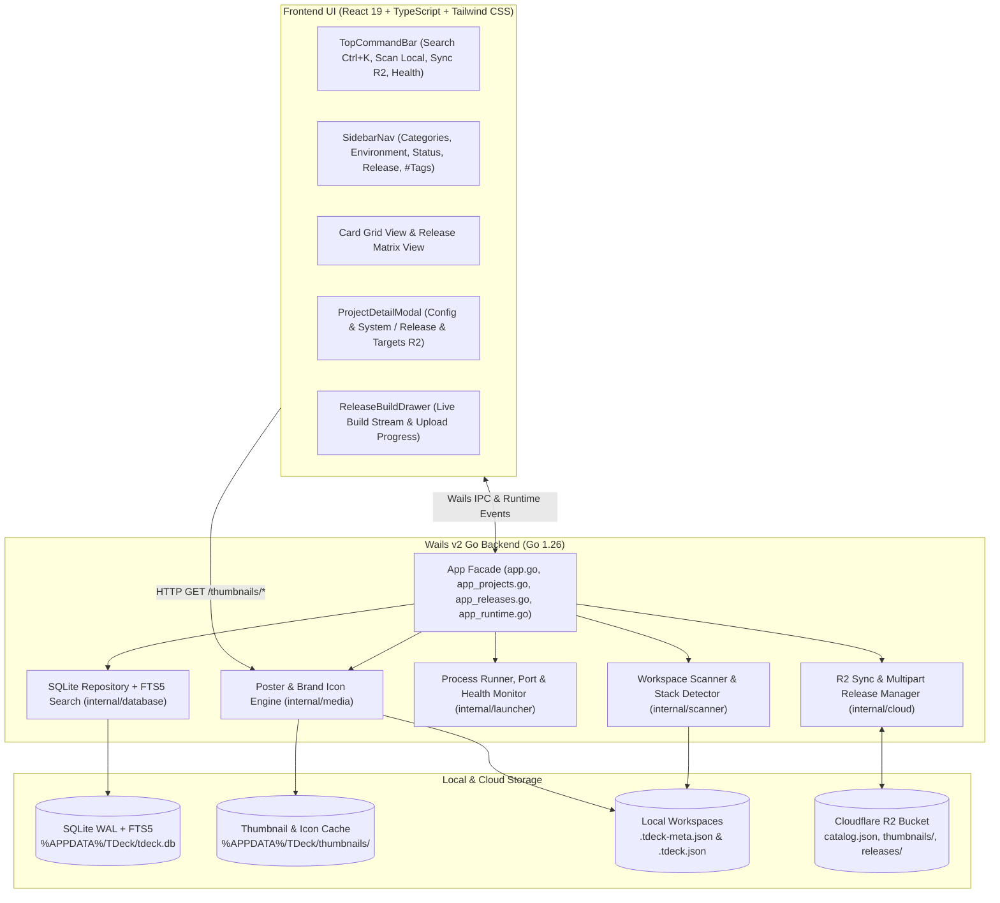

# T-Deck — Local-First Workspace & Hybrid Release Control Plane


**T-Deck** là ứng dụng desktop điều phối danh mục phần mềm (App Catalog), khởi chạy môi trường phát triển (Workspace Launcher) và quản lý phát hành đa nền tảng (Hybrid Web & Desktop Release Manager) được xây dựng trên **Wails v2 (Go + WebView2)**, **React 19**, **SQLite FTS5** và **Cloudflare R2**.

Thiết kế theo triết lý **Local-First & Zero-Server**: mọi thao tác tìm kiếm, quét ổ đĩa, khởi chạy tiến trình và kết xuất đồ họa đều diễn ra tức thì trên máy cục bộ qua SQLite; việc đồng bộ danh mục dự án, ảnh nhận diện và gói cài đặt (`.zip` / `.exe`) giữa nhiều máy tính sử dụng trực tiếp **Cloudflare R2 (S3-compatible Object Storage)** mà không cần duy trì backend server trung gian.

---

## Mục lục

- [Điểm nổi bật (Highlights)](#điểm-nổi-bật-highlights)
- [Kiến trúc tổng quan](#kiến-trúc-tổng-quan)
- [Tính năng cốt lõi](#tính-năng-cốt-lõi)
- [Cài đặt & Khởi chạy nhanh (Quick Start)](#cài-đặt--khởi-chạy-nhanh-quick-start)
- [Hướng dẫn sử dụng nhanh](#hướng-dẫn-sử-dụng-nhanh)
- [Cấu trúc thư mục dự án](#cấu-trúc-thư-mục-dự-án)
- [Hệ thống tài liệu (Documentation Hub)](#hệ-thống-tài-liệu-documentation-hub)
- [Đóng góp & Bảo mật](#đóng-góp--bảo-mật)

---

## Điểm nổi bật (Highlights)

- **Tự động phát hiện dự án thông minh (`Scan Local`)**: Quét sâu ổ đĩa và các thư mục chứa workspace (`D:\`, `D:\app`, `C:\TDeckApps`), tự động nhận diện ngôn ngữ/framework (Go, Wails, React, Vite, Next.js, Electron, Tauri, Python, Java/Spring Boot, Maven/Gradle, Rust, Docker) và lọc bỏ hoàn toàn các phần mềm cài sẵn của bên thứ ba (DB clients, VPN, trình duyệt, SDK/runtime).
- **Tự động trích xuất Brand Logo & Kết xuất Poster 16:9**:
  - Tự động dò tìm bộ icon thương hiệu (`.png` / `.ico` hỗ trợ cả frame PNG nhúng lẫn 32-bit BGRA DIB) trong thư mục dự án khi bấm **Scan Local**.
  - Với dự án **có bộ icon**: tự động gắn **App Icon Badge** cạnh tên dự án trên Card, bảng Release Matrix và cửa sổ Chi tiết; đồng thời kết xuất logo vào góc trái (`APP ICON`) và khung kính tối (Hero Emblem) trên poster 16:9 (`1280×720`).
  - Với dự án **chưa có bộ icon**: giữ nguyên 100% poster kỹ thuật 16:9 được vẽ tự động theo nhóm ngành nghề và tech stack.
- **Neo danh tính bất biến qua `.tdeck-meta.json`**: Mỗi dự án được gắn một UUID duy nhất ngay trong thư mục mã nguồn. Dù đổi tên thư mục hay di chuyển dự án sang ổ đĩa khác, T-Deck vẫn tự động relink chính xác mà không tạo bản ghi trùng lặp.
- **Khởi chạy 1 chạm & Bảo vệ `.env` an toàn**: Hỗ trợ chạy trực tiếp `.exe` hoặc `.bat` ở chế độ tách biệt (detached process). Tự động chặn lỗi thiếu `.env` bằng cách khởi tạo từ `.env.example` và mở trình soạn thảo trước khi chạy.
- **Giám sát Tiến trình, Cổng mạng & Sức khỏe Web (Live Monitor)**: Theo dõi thời gian thực các dự án đang chạy (PID, cổng TCP đang lắng nghe, nút **Dừng** trực tiếp trên thẻ) và kiểm tra đồng thời trạng thái HTTP + độ lệch phiên bản (version drift) của toàn bộ Web targets.
- **Quản lý Phát hành Hybrid (Web + Desktop) qua Cloudflare R2**: Một dự án có thể chứa đồng thời nhiều đích phát hành (`Web App`, `Desktop Portable .zip`, `Desktop Installer .exe`), hỗ trợ lịch sử phiên bản (`stable`, `beta`, `canary`), kiểm tra toàn vẹn `SHA-256`, cập nhật nguyên tử (atomic update) kèm khôi phục bản cũ (`.bak` rollback), tạo link tải Presigned URL và feed `latest.json` cho Auto-Updater.

---

## Kiến trúc tổng quan



---

## Tính năng cốt lõi

| Phân hệ | Tính năng chi tiết |
|---|---|
| **1. Quét & Nhận diện (`internal/scanner`)** | • Quét đa ổ đĩa và thư mục container (`D:\`, `D:\app`, `AppsDir`).<br>• Nhận diện hơn 25 dấu hiệu công nghệ (`.tdeck.json`, `wails.json`, `package.json`, `go.mod`, `Cargo.toml`, `pom.xml`, `pyproject.toml`, `docker-compose.yml`...).<br>• Bộ lọc đa tầng loại trừ thư mục rác, bộ cài đặt và phần mềm bên thứ ba.<br>• Tự động trích xuất mô tả từ `README.md`, Git remote URL, Git tag/commit version và phân nhóm tự động. |
| **2. Nhận diện Thương hiệu (`internal/media`)** | • Tự động tìm icon vuông chất lượng cao (`48px–2048px`) từ `.png` và `.ico` (`build/appicon.png`, `public/apple-touch-icon.png`, `web/public/icon-512.png`, `icons/icon128.png`, `build/icon.ico`...).<br>• Xuất `<id>.icon.png` (`128×128`) hiển thị trực tiếp cạnh tên dự án trên toàn bộ giao diện.<br>• Kết xuất poster `1280×720` (`16:9`) thuần Go (không phụ thuộc trình duyệt ngầm hay công cụ ngoài). |
| **3. Tìm kiếm & Lọc Đa chiều (`internal/database`)** | • Tìm kiếm toàn văn **SQLite FTS5** theo tên, slug, mô tả chức năng, tech stack và `#tags`.<br>• Lọc giao nhau theo: **Phân loại (Nhóm)**, **Môi trường** (`Web` / `Desktop` / `Hybrid`), **Trạng thái cục bộ** (`Sẵn sàng`, `Chưa tải Cloud`, `Thiếu .env`, `Thiếu thư mục`), **Release & Chạy**, và **Tags**.<br>• 8 chế độ sắp xếp + chế độ **Chọn nhiều** để xóa hàng loạt an toàn (chỉ gỡ khỏi danh mục, không xóa thư mục gốc). |
| **4. Khởi chạy & Tiện ích Máy trạm (`internal/launcher`)** | • Chạy `.bat` / `.exe` độc lập, tự động ghi nhận `last_launched_at` và số lần chạy.<br>• **Pre-flight `.env` Guard**: tự động copy `.env.example` → `.env` và mở Notepad khi thiếu cấu hình.<br>• Tích hợp trình tạo nhanh `start.bat` (5 mẫu chuẩn: Node/Vite, Python venv, Go/Wails, Docker Compose, Custom) và công cụ **Sync `.env.example`** tự động xóa sạch secret sau dấu `=`.<br>• Mở nhanh thư mục trong **File Explorer**, **VS Code** hoặc **Windows Terminal / CMD**. |
| **5. Phát hành & Đồng bộ Đám mây (`internal/cloud`)** | • Đồng bộ 2 chiều `catalog.json` v2 (projects, categories, targets, latest releases, tombstones `deleted_at`) và bộ ảnh `thumbnails/` qua Cloudflare R2.<br>• Tải lên gói phát hành với **Multipart Upload**, theo dõi tiến trình thời gian thực và kiểm tra băm `SHA-256`.<br>• Hỗ trợ cài đặt mới lên máy tính khác (**Install R2** / **Git Clone**), nâng cấp bản mới (**Update**) và khôi phục bản cũ (**Rollback** từ `.bak`). |

---

## Cài đặt & Khởi chạy nhanh (Quick Start)

### 1. Yêu cầu môi trường (Prerequisites)

- **Hệ điều hành**: Windows 10 / 11 (64-bit) với Microsoft Edge WebView2 Runtime.
- **Go**: `>= 1.26` (sử dụng Pure-Go SQLite `modernc.org/sqlite`, **không** yêu cầu cài đặt GCC/CGO).
- **Node.js & npm**: `>= 20.x` (để biên dịch giao diện React 19 + Vite 7).
- **Wails CLI**: `v2.16.0+`
  ```powershell
  go install github.com/wailsapp/wails/v2/cmd/wails@latest
  ```
- *(Tùy chọn)* **NSIS (`makensis.exe`)**: Nếu muốn đóng gói bộ cài `TDeck-amd64-installer.exe`.

### 2. Sao chép mã nguồn & Cấu hình biến môi trường

```powershell
git clone https://github.com/your-org/t-deck.git
cd t-deck
Copy-Item .env.example .env
```

Chỉnh sửa file `.env` (hoặc cấu hình trực tiếp trên giao diện **Cài đặt ⚙️** sau khi mở ứng dụng):

```dotenv
# Danh sách thư mục gốc chứa mã nguồn (phân tách bằng dấu ; hoặc ,)
TDECK_WORKSPACE_DIRS=D:\app;D:\projects
# Thư mục cài đặt các ứng dụng Desktop tải từ R2
TDECK_APPS_DIR=C:\TDeckApps
# Số ngày hoạt động gần đây để lọc khi quét
TDECK_SCAN_RECENT_DAYS=120
# Danh sách tên thư mục bỏ qua khi quét
TDECK_SCAN_EXCLUDE_DIRS=node_modules,dist,build,vendor

# Cấu hình Cloudflare R2 (tùy chọn nếu dùng tính năng Sync R2 & Release)
R2_ENABLED=true
R2_ACCOUNT_ID=your_cloudflare_account_id
R2_ENDPOINT=https://your_cloudflare_account_id.r2.cloudflarestorage.com
R2_BUCKET=tdeck-storage
R2_ACCESS_KEY=your_r2_access_key_id
R2_SECRET_KEY=your_r2_secret_access_key
R2_PUBLIC_DOMAIN=https://cdn.example.com
```

### 3. Chạy chế độ phát triển (Live Development)

```powershell
wails dev
```

### 4. Đóng gói bản chạy chính thức (`build.bat`)

Dự án đi kèm script [build.bat](file:///d:/app/t-deck/build.bat) tự động hóa toàn bộ quy trình biên dịch, kiểm tra lỗi và đóng gói:

```powershell
# Cách 1: Mở menu tương tác (chọn chế độ 1..5)
.\build.bat

# Cách 2: Build đầy đủ Frontend + Go backend ra build\bin\TDeck.exe
.\build.bat full

# Cách 3: Build đầy đủ và tự động khởi chạy ngay TDeck.exe
.\build.bat full run

# Cách 4: Build nhanh chỉ Go backend (giữ nguyên frontend\dist đã build)
.\build.bat fast

# Cách 5: Đóng gói bộ cài đặt Windows NSIS (build\bin\TDeck-amd64-installer.exe)
.\build.bat installer
```

---

## Hướng dẫn sử dụng nhanh

1. **Quét dự án trên máy (`Scan Local`)**:
   - Bấm nút **Scan Local** trên thanh công cụ trên cùng.
   - T-Deck hiển thị màn hình tiến trình quét ở giữa màn hình, tự động phát hiện tất cả dự án hợp lệ, tạo file `.tdeck-meta.json`, kết xuất poster 16:9 (kèm logo nhận diện cho các dự án có bộ icon) và hiển thị danh sách với hiệu ứng skeleton tuần tự.
2. **Tìm kiếm & Lọc dự án**:
   - Nhấn `Ctrl+K` để nhảy nhanh vào ô tìm kiếm FTS5 (gõ tên dự án, công nghệ như `wails`, `react`, hoặc mô tả như `dịch video`).
   - Kết hợp bộ lọc bên thanh trái theo **Nhóm**, **Môi trường (`Web` / `Desktop` / `Hybrid`)**, **Trạng thái**, **Đang chạy** hoặc **#Tags**.
   - Chuyển đổi giữa **Chế độ Lưới (Card Grid)** và **Chế độ Bảng (Release Matrix)** bằng cụm nút góc phải thanh tìm kiếm.
3. **Khởi chạy & Quản lý cấu hình dự án**:
   - Bấm **Launch** (với ứng dụng `.exe`) hoặc **Run .bat** (với ứng dụng Web/Script).
   - Nếu dự án báo **Cấu hình .env**, bấm vào nút để T-Deck tự tạo `.env` từ `.env.example` và mở trình sửa.
   - Bấm biểu tượng **Chi tiết & Cấu hình** (hoặc click vào tên dự án trong bảng Matrix) để mở hộp thoại Inspector: chỉnh sửa thông tin, tạo `start.bat` mẫu, xóa sạch secret trong `.env.example`, hoặc đổi ảnh đại diện (kéo thả, chọn file, nhấn `Ctrl+V`, hoặc bấm **Tạo theo mô tả**).
4. **Phát hành & Đồng bộ đa máy qua Cloudflare R2**:
   - Mở tab **Phát hành & Targets (R2)** trong cửa sổ chi tiết dự án để định nghĩa các đích phát hành (`Web` hoặc `Desktop`), chạy lệnh build trực tiếp có log thời gian thực, tự động trích xuất Changelog từ Git và đẩy bản phát hành lên Cloudflare R2.
   - Bấm **Sync R2** trên thanh công cụ để đồng bộ danh mục và ảnh preview giữa các máy trạm.

> Xem hướng dẫn đầy đủ từng bước tại **[Hướng dẫn sử dụng chi tiết (docs/USER_GUIDE.md)](file:///d:/app/t-deck/docs/USER_GUIDE.md)**.

---

## Cấu trúc thư mục dự án

```text
t-deck/
├── main.go                           # Điểm vào Wails, cấu hình cửa sổ Maximised & middleware /thumbnails/*
├── app.go                            # Struct App chính & khởi tạo dịch vụ nền
├── app_projects.go                   # Wails IPC methods: CRUD dự án, categories, thumbnail, Explorer/IDE
├── app_releases.go                   # Wails IPC methods: Targets, Build, Publish R2, Install/Update/Rollback
├── app_runtime.go                    # Wails IPC methods: Scan Local, Sync R2, Health check, Process Monitor
├── app_settings.go                   # Wails IPC methods: Đọc/lưu Settings & kiểm tra kết nối R2
├── build.bat                         # Script đóng gói tự động (fast | full | clean | fe | installer)
├── wails.json                        # Cấu hình Wails v2
├── .env.example                      # Mẫu cấu hình biến môi trường & R2 credentials
├── cmd/
│   └── tdeck-sync/main.go            # Công cụ CLI quét batch, tạo poster & publish release tự động
├── internal/
│   ├── apperr/                       # Chuẩn hóa mã lỗi có cấu trúc cho tầng IPC
│   ├── cloud/                        # S3/R2 client, đồng bộ catalog.json v2, multipart release, zip/unzip
│   ├── config/                       # Hằng số hệ thống, SettingsManager & tách biệt secrets vào .env
│   ├── database/                     # SQLite WAL, schema migrations, FTS5 full-text search & repositories
│   ├── fsutil/                       # Tiện ích kiểm tra file, tạo slug, chuẩn hóa chuỗi
│   ├── launcher/                     # Thực thi .bat/.exe, mẫu start.bat, giám sát PID/Port & Web Health
│   ├── media/                        # Kết xuất poster 16:9 thuần Go & tự động trích xuất Brand Icon (.png/.ico)
│   ├── model/                        # Các kiểu dữ liệu miền (Project, ProjectView, Target, Release, Catalog)
│   └── scanner/                      # Quét ổ đĩa, nhận diện stack, lọc app bên thứ 3, đọc .tdeck.json
├── frontend/
│   └── src/
│       ├── App.tsx                   # Điều phối giao diện chính, phím tắt toàn cục & modals
│       ├── hooks/                    # Custom hooks: useProjectFilters, useBulkSelection, useRuntimeEvents...
│       ├── components/               # Các thành phần giao diện chia tách theo miền chức năng
│       │   ├── catalog/              # CatalogToolbar, CatalogEmptyState
│       │   ├── inspector/            # ProjectDetailModal, InspectorConfigTab, InspectorReleaseTab...
│       │   ├── project/              # ProjectCardPreview, ProjectPrimaryActionButton, ReleaseMatrixRow
│       │   ├── settings/             # SettingsModal, WorkspaceSettingsSection, R2SettingsSection
│       │   ├── sidebar/              # SidebarCategorySection
│       │   └── ui/                   # ModalDialog, ConfirmPopover, ThumbnailUploader, ErrorBoundary
│       ├── lib/                      # Cầu nối Wails IPC (api.ts), xử lý ảnh clipboard & định dạng
│       └── types/                    # Khai báo TypeScript khớp 1-1 với Go models
└── docs/                             # Trung tâm tài liệu kiến trúc, hướng dẫn sử dụng & đặc tả kỹ thuật
```

---

## Hệ thống tài liệu (Documentation Hub)

Toàn bộ tài liệu mở rộng của dự án được tổ chức chi tiết theo từng vai trò:

| Tài liệu | Nội dung chi tiết |
|---|---|
| **[docs/USER_GUIDE.md](file:///d:/app/t-deck/docs/USER_GUIDE.md)** | Hướng dẫn sử dụng đầy đủ từ A–Z cho người dùng cuối: cài đặt, quét dự án, bộ lọc, khởi chạy, xử lý `.env`, quản lý bản phát hành R2 và xử lý sự cố. |
| **[docs/FEATURES.md](file:///d:/app/t-deck/docs/FEATURES.md)** | Danh mục tính năng chuyên sâu và cơ chế hoạt động của từng phân hệ (Scanner, Brand Icon Engine, FTS5, Process Monitor, Hybrid Release). |
| **[docs/CONFIGURATION.md](file:///d:/app/t-deck/docs/CONFIGURATION.md)** | Đặc tả cấu hình hệ thống (`settings.json`, `.env`), chuẩn file neo `.tdeck-meta.json`, chuẩn manifest `.tdeck.json` và cấu trúc lưu trữ trên Cloudflare R2. |
| **[docs/CLI.md](file:///d:/app/t-deck/docs/CLI.md)** | Hướng dẫn sử dụng công cụ dòng lệnh `tdeck-sync` và script đóng gói `build.bat` cho tự động hóa & CI/CD. |
| **[docs/ARCHITECTURE.md](file:///d:/app/t-deck/docs/ARCHITECTURE.md)** | Kiến trúc hệ thống, sơ đồ luồng dữ liệu, thiết kế cơ sở dữ liệu SQLite và các quyết định kiến trúc (ADRs). |
| **[docs/README.md](file:///d:/app/t-deck/docs/README.md)** | Tổng quan tài liệu kỹ thuật và lộ trình phát triển các giai đoạn (`specs/01..04`). |
| **[CONTRIBUTING.md](file:///d:/app/t-deck/CONTRIBUTING.md)** | Quy chuẩn mã nguồn Go & React/TypeScript, quy trình kiểm thử (`go test`, `-race`, `tsc`) và hướng dẫn đóng góp. |
| **[SECURITY.md](file:///d:/app/t-deck/SECURITY.md)** | Chính sách bảo mật, cơ chế cô lập khóa bí mật R2, chống lỗ hổng Zip-Slip và kiểm tra toàn vẹn `SHA-256`. |
| **[CHANGELOG.md](file:///d:/app/t-deck/CHANGELOG.md)** | Nhật ký thay đổi và lịch sử các phiên bản của T-Deck. |

---

## Kiểm thử & Đảm bảo chất lượng

```powershell
# Chạy toàn bộ bộ kiểm thử đơn vị & tích hợp phía Go
go test -v -count=1 ./...

# Chạy kiểm thử phát hiện xung đột luồng (Race Detector)
go test -race -count=1 ./...

# Kiểm tra kiểu tĩnh TypeScript và đóng gói giao diện React
cd frontend
npm run build
```

---

## Đóng góp & Bảo mật

- Mọi đóng góp tính năng, báo lỗi hoặc cải thiện hiệu năng vui lòng tham khảo **[CONTRIBUTING.md](file:///d:/app/t-deck/CONTRIBUTING.md)**.
- Các vấn đề liên quan đến an toàn thông tin và bảo mật cấu hình được mô tả chi tiết tại **[SECURITY.md](file:///d:/app/t-deck/SECURITY.md)**.
