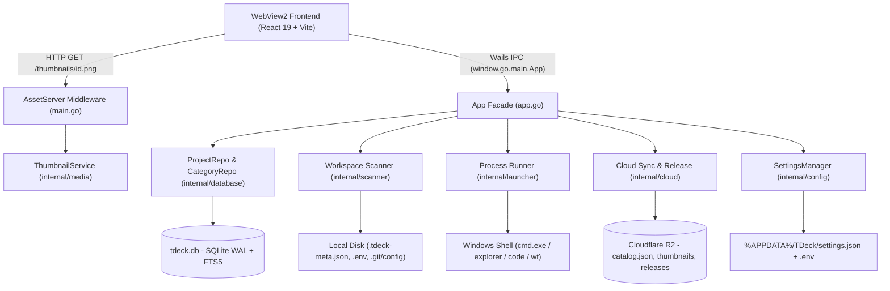
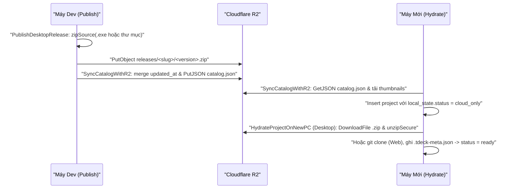
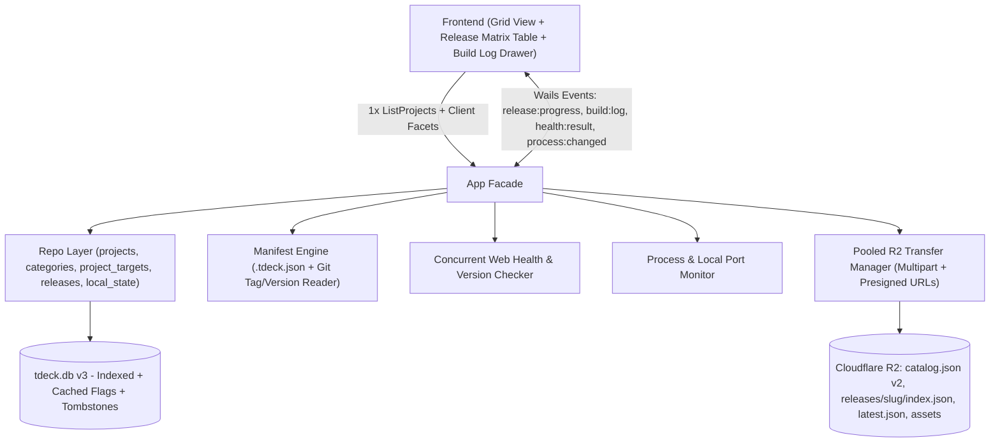

# Kiến trúc Hệ thống T-Deck (Hiện tại & Mục tiêu V2)

## 1. Tech Stack & Runtime Topology

| Thành phần | Công nghệ hiện tại | Vai trò trong hệ thống |
|---|---|---|
| **Desktop Shell** | Wails v2 (`github.com/wailsapp/wails/v2 v2.16.0`) | Nhúng `frontend/dist` qua `embed.FS`, tạo WebView2 window (`1340×840`, min `1024×680`), cung cấp IPC Go↔JS bridge và AssetServer middleware. |
| **Backend Core** | Go `1.26.0` | Xử lý disk scanning, Git/OS process execution, nén/giải nén zip, tạo ảnh PNG, quản lý cấu hình và kết nối Cloudflare R2. |
| **Database** | `modernc.org/sqlite v1.62.0` (Pure-Go SQLite + FTS5) | Lưu trữ cục bộ không cần CGO (`tdeck.db`), chạy chế độ `WAL`, tìm kiếm toàn văn FTS5 theo tên, mô tả, tags và tech stack. |
| **Cloud Object Storage** | `aws-sdk-go-v2` + `service/s3` | Giao tiếp S3-compatible endpoint của Cloudflare R2 (`https://<account_id>.r2.cloudflarestorage.com`) để sync `catalog.json`, thumbnails và release bundles. |
| **Frontend UI** | React `19.1.0`, TypeScript `5.6.3`, Vite `7.0.0`, Tailwind `3.4.17` | Giao diện dark desktop-first, icon `lucide-react`, font offline `@fontsource/inter`, `@fontsource/plus-jakarta-sans`, `@fontsource/jetbrains-mono`. |
| **CLI Companion** | `cmd/tdeck-sync/main.go` | Công cụ dòng lệnh chạy scan, sinh thumbnail tự động và publish batch desktop releases lên R2. |

---

## 2. Bản đồ Repository & Trách nhiệm Module

### Cây thư mục thực tế
```text
t-deck/
├── main.go                           # Entry Wails, embed frontend/dist, middleware /thumbnails/*
├── app.go                            # App struct facade (~25 Wails-bound methods)
├── wails.json                        # Cấu hình build Wails (output: TDeck.exe)
├── cmd/tdeck-sync/main.go            # CLI batch scan, auto-thumbnail & publish desktop releases
├── internal/
│   ├── model/project.go              # Domain models: Category, Project, LocalState, ProjectView, Catalog...
│   ├── config/
│   │   ├── constants.go              # Tên file, R2 prefixes, trạng thái, IgnoredDirs, Env keys
│   │   ├── settings.go               # SettingsManager (settings.json + .env overrides)
│   │   └── env_loader.go             # Đọc/ghi .env (giữ secrets ngoài settings.json)
│   ├── database/
│   │   ├── sqlite.go                 # Mở SQLite WAL, schemaDDL & migrateColumns
│   │   ├── project_repo.go           # ProjectRepo CRUD, FTS5 filter query, enrichLocalFlags
│   │   ├── category_repo.go          # Category CRUD & RenameCategory/DeleteCategory atomic tx
│   │   └── fts.go                    # syncFTSTx, buildFTSQuery, normalizeTags
│   ├── scanner/
│   │   ├── scanner.go                # Walk workspaceDirs/appsDir, đọc/ghi .tdeck-meta.json, relink
│   │   ├── detector.go               # Nhận diện stack (Go/Wails, Node/Electron/Vite, Python, Java, Android)
│   │   ├── metadata.go               # ComputeLocalStatus, CleanMarkdownSummary, parseGitRemote
│   │   └── env_parser.go             # Tạo .env.example xóa giá trị bí mật sau '='
│   ├── launcher/
│   │   ├── runner.go                 # Pre-flight .env guard, chạy .bat/.exe detached, OpenInExplorer/Editor
│   │   └── templates.go              # 5 mẫu start.bat chuẩn + AutoCreateStartBat
│   ├── cloud/
│   │   ├── r2_client.go              # ObjectStore interface & R2Client (aws-sdk-go-v2 S3)
│   │   ├── catalog_sync.go           # Sync 2 chiều catalog.json (theo updated_at) & thumbnails
│   │   ├── release_manager.go        # PublishDesktopRelease & HydrateProjectOnNewPC (desktop/web)
│   │   └── archive.go                # zipSource & unzipSecure (chống zip-slip)
│   ├── media/
│   │   ├── thumbnail.go              # SaveClipboardPNG, ServeHTTP (/thumbnails/<id>.png), Generate
│   │   └── generator.go              # Render ảnh preview PNG 1280×720 bằng golang.org/x/image
│   └── fsutil/fs.go                  # FileExists, DirExists, Slugify, UniqueStrings
└── frontend/src/
    ├── App.tsx                       # Root state, search debounce, loadQueryMatched + loadFiltered
    ├── lib/api.ts                    # Typed wrapper gọi window.go.main.App.*
    ├── lib/clipboard.ts              # Đọc ảnh paste/drop/file và chuyển sang PNG data URL
    ├── types/project.ts              # Interfaces khớp 1-1 với Go structs
    └── components/
        ├── TopCommandBar.tsx         # Thanh tìm kiếm Ctrl+K, nút Scan Local, Sync R2, Thêm, Settings
        ├── SidebarNav.tsx            # Bộ lọc faceted (Nhóm, Môi trường, Trạng thái, #Tags)
        ├── ProjectCard.tsx           # Card 16:9, drag/drop/paste thumbnail, Launch/Install/Clone
        ├── AddProjectModal.tsx       # Modal tạo project mới
        ├── ToastStack.tsx            # Thông báo trạng thái góc phải dưới
        ├── inspector/
        │   ├── ProjectDetailModal.tsx # Popup 980px 3 tab (Config / Release / System)
        │   ├── InspectorConfigTab.tsx # Sửa metadata, tạo start.bat, sync .env.example
        │   ├── InspectorReleaseTab.tsx # Publish desktop .zip lên R2
        │   └── InspectorSystemTab.tsx # Copy UUID, mở Explorer/VS Code/Terminal, xóa project
        ├── settings/
        │   ├── SettingsModal.tsx     # Lưu SettingsManager
        │   ├── WorkspaceSettingsSection.tsx # WorkspaceDirs, AppsDir, RecentDays, ExcludeDirs
        │   └── R2SettingsSection.tsx # Cấu hình R2 + TestConnection
        └── ui/                       # FormField, ModalDialog (<dialog>), ThumbnailUploader, uiTokens
```

---

## 3. Sơ đồ Kiến trúc & Luồng Dữ liệu Cốt lõi

### 3.1. Kiến trúc Tổng thể Hiện tại (v1)



### 3.2. Cơ chế Neo Danh tính (`.tdeck-meta.json`) & Bảo mật Secrets
1. **Relink xuyên đường dẫn & xuyên máy**: Mỗi project được cấp 1 `UUID` bất biến lưu trong `<local_dir>/.tdeck-meta.json` (`project_id`, `slug`, `type`). Khi người dùng di chuyển thư mục sang ổ đĩa khác, `Scanner` đọc `.tdeck-meta.json` và tự động cập nhật `local_state.local_dir` mà không tạo bản sao rác.
2. **Pre-flight `.env` Guard**: Trước khi chạy Web App qua `start.bat`, `Runner.launchWeb` kiểm tra: nếu thiếu `.env` nhưng có `.env.example`, T-Deck tự sao chép `.env.example` → `.env`, đổi trạng thái thành `missing_env`, mở `notepad.exe` để điền biến môi trường và dừng launch an toàn.
3. **Tách biệt Secrets (`settings.json` vs `.env`)**: `SettingsManager.Save()` chủ động xóa `AccessKeyID` và `SecretAccessKey` khỏi `settings.json` (`diskCopy`) khi lưu xuống đĩa và chỉ ghi credentials vào `.env` (quyền `0600`), bảo đảm thông tin nhạy cảm không bao giờ rò rỉ vào `catalog.json` hoặc config backup.

### 3.3. Luồng Đồng bộ Đa Máy & Phát hành (v1 Hiện tại)



---

## 4. Lỗ hổng Kiến trúc Hiện tại & Thiết kế Mục tiêu V2

### 4.1. Các giới hạn cốt lõi đang tồn tại trong codebase v1
1. **Ràng buộc nhị phân `web | desktop`**: Trong `sqlite.go`, `projects.type` chỉ chấp nhận `'web'` hoặc `'desktop'`. Dự án có cả bản Web (portal/dashboard/API) và Desktop App (client/installer) buộc phải tạo 2 card rời hoặc mất khả năng quản lý release Web.
2. **Release chỉ là 3 cột phẳng trên bảng `projects`**: Không lưu được lịch sử các phiên bản (`v1.0.0`, `v1.1.0`...), không có SHA-256, không phân biệt `channel` (`stable`/`beta`), không biết phiên bản hiện cài ở máy (`installed_version`) so với bản mới nhất trên R2 hay bản Web đang live.
3. **Thiếu đồng bộ `categories` & thiếu Tombstone khi xóa**:
   - `model.Catalog` đã có trường `Categories`, `category_repo.go` đã viết hàm `UpsertCategories`, nhưng `SyncCatalogWithR2` chưa từng đồng bộ danh sách `categories`.
   - `DeleteProject` xóa cứng bản ghi khỏi SQLite cục bộ. Khi chạy `SyncCatalogWithR2`, `catalog.json` trên R2 vẫn còn project đó nên kéo ngược về máy vừa xóa ("hồi sinh" project).
4. **Hiệu năng suy giảm khi mở rộng quy mô**:
   - `ProjectRepo.enrichLocalFlags` chạy 4 `os.Stat` trên từng dòng khi `ListProjects`; Frontend gọi `ListProjects` 2 lần mỗi thao tác.
   - `Scanner.relinkExistingProject` gọi `ListAllLocalStates()` bên trong từng project ($O(N^2)$).
   - `R2Client` khởi tạo lại cho mỗi lệnh gọi, tải/upload thumbnail tuần tự kèm `HeadObject` thừa, chưa hỗ trợ multipart cho file cài đặt lớn.
5. **Automation còn thủ công**: `cmd/tdeck-sync/main.go` hardcode map `desktopReleases` cho 6 tên project cố định; thiếu manifest chuẩn tại repo để GUI và CLI dùng chung.

### 4.2. Kiến trúc Mục tiêu V2 (Sau Phase 1–3)



---

## 5. Quyết định Kiến trúc Cốt lõi (ADRs)

- **ADR-01 — Kiến trúc Local-First + R2 Object Storage (Zero Backend Server)**: Không dựng REST API hay database server trung tâm. SQLite đóng vai trò nguồn dữ liệu phản hồi tức thì ở local; R2 lưu trữ trạng thái chia sẻ (`catalog.json` v2 + `releases/<slug>/index.json`) theo cơ chế merge timestamp + soft-delete tombstones.
- **ADR-02 — Tách `catalog.json` và `releases/<slug>/index.json`**: Giữ `catalog.json` gọn nhẹ (chỉ chứa metadata project, categories, targets và summary bản latest) để sync đa máy dưới 1 giây; toàn bộ lịch sử release dài hạn được tách theo từng project tại `releases/<slug>/index.json` và tải theo nhu cầu khi mở chi tiết hoặc sync sâu.
- **ADR-03 — Tách Target (`web` / `desktop`) khỏi Project**: Một `Project` có thể sở hữu $0..N$ `project_targets` (ví dụ: 1 Web App + 1 Windows Installer + 1 Portable `.zip`). Mọi đường dẫn cục bộ, version đang cài và trạng thái git vẫn neo vào `local_state` riêng theo từng máy.
- **ADR-04 — Hợp nhất CLI `tdeck-sync` và GUI qua `.tdeck.json`**: Không duy trì cấu hình release riêng trong code Go. Quy tắc build, đường dẫn artifact, URL web và cách đọc version nằm trong `.tdeck.json` tại thư mục gốc từng repo.
- **ADR-05 — Pure-Go SQLite & Offline Font Bundling**: Tiếp tục sử dụng `modernc.org/sqlite` (không cần GCC/CGO khi build Windows) và tối giản font `.woff2` bundled để `TDeck.exe` hoạt động offline hoàn toàn với dung lượng tối ưu.
