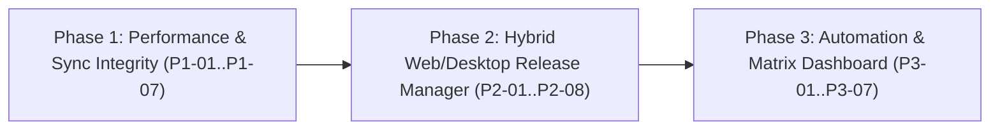

# Kế hoạch Thực thi Nâng cấp T-Deck (`PLAN.md`)

**Phạm vi:** Nâng cấp toàn diện T-Deck qua 3 giai đoạn từ Local Project Launcher (v1) thành **Hybrid Web & Desktop Release Control Plane (V2)** với hiệu năng cao và đồng bộ đa máy an toàn.

---

## 1. Mục tiêu Tổng thể

1. **Hiệu năng mượt ở quy mô 100+ dự án**: Loại bỏ N+1 `os.Stat` khi load danh sách, chuyển lọc faceted về client (0 IPC), tối ưu `Scanner` còn $O(N)$ và tăng tốc sync R2 qua connection pooling + worker pool.
2. **Toàn vẹn dữ liệu đa máy**: Đồng bộ đầy đủ `categories` và soft-delete tombstones (`deleted_at`) để không bị hồi sinh project/category đã xóa.
3. **Quản lý Release trọn vòng đời cho cả Web & Desktop App**: Hỗ trợ dự án `hybrid`, lịch sử nhiều phiên bản, kiểm tra health & lệch version Web live, đóng gói web static `dist.zip`, cập nhật/rollback nguyên tử Desktop App, chia sẻ link tải public/presigned, manifest `.tdeck.json`, auto-updater `latest.json` và chế độ bảng **Release Matrix View**.

---

## 2. Đồ thị Phụ thuộc giữa các Phases

---

## 3. Bảng Danh sách Tickets Chi tiết (22 Tickets)

### Phase 1 — Tối ưu Hiệu năng & Toàn vẹn Đồng bộ
Xem chi tiết kỹ thuật tại [specs/01-performance-and-sync.md](specs/01-performance-and-sync.md).

| ID | Tiêu đề | File chạm chính | Phụ thuộc | Ưu tiên | Xác minh |
|---|---|---|---|---|---|
| `P1-01` | DB Migration v2, Pragmas & Cached `has_env`/`has_bat` + Thumbnail Cache | `internal/database/{sqlite.go,project_repo.go}`, `internal/scanner/scanner.go`, `internal/launcher/runner.go` | - | P0 | `go test ./internal/database/...` |
| `P1-02` | Client-side Faceted Filtering (1 IPC call) & `React.memo` + Sidebar 1-pass | `frontend/src/App.tsx`, `frontend/src/lib/facets.ts`, `frontend/src/components/{SidebarNav.tsx,ProjectCard.tsx}` | `P1-01` | P0 | `npm run build` + kiểm đếm network/IPC call |
| `P1-03` | Tối ưu `Scanner` ($O(N)$ DB reads, Early-Exit ModTime, Skip `findBuiltExe` thừa, Worker Pool) | `internal/scanner/{scanner.go,detector.go,metadata.go}` | `P1-01` | P0 | `go test -race ./internal/scanner/...` |
| `P1-04` | Thumbnail HTTP Cache (`immutable`) & Client-side Resize `1280×720` | `internal/media/thumbnail.go`, `frontend/src/lib/clipboard.ts` | - | P1 | Kiểm tra response header & kích thước PNG đầu ra |
| `P1-05` | R2 Connection Pooling & Concurrent Thumbnail Sync (bỏ `HeadObject` thừa) | `app.go`, `internal/cloud/{r2_client.go,catalog_sync.go}` | - | P1 | `go test -race ./internal/cloud/...` |
| `P1-06` | Sync 2 chiều `Categories` & Soft-Delete Tombstones (`deleted_at`, giữ 90 ngày) | `internal/model/project.go`, `internal/database/{project_repo.go,category_repo.go}`, `internal/cloud/catalog_sync.go` | `P1-01` | P0 | Unit test sync xóa + sync category 2 chiều |
| `P1-07` | Tối ưu Font Assets (chỉ bundle `.woff2` subset cần thiết) | `frontend/src/main.tsx`, `frontend/vite.config.ts` | - | P2 | `npm run build` & kiểm tra kích thước `frontend/dist/assets` |

### Phase 2 — Hybrid Web & Desktop Release Manager
Xem chi tiết kỹ thuật tại [specs/02-hybrid-release-manager.md](specs/02-hybrid-release-manager.md) và [specs/04-data-and-api-contracts.md](specs/04-data-and-api-contracts.md).

| ID | Tiêu đề | File chạm chính | Phụ thuộc | Ưu tiên | Xác minh |
|---|---|---|---|---|---|
| `P2-01` | DB Migration v3 (`project_targets`, `releases`, `hybrid` type, `installed_version`, backfill v1) | `internal/database/{sqlite.go,target_repo.go,release_repo.go}`, `internal/model/project.go` | `P1-06` | P0 | Migration test từ v2→v3 trên DB mẫu có sẵn dữ liệu |
| `P2-02` | CRUD Targets Đa Nền Tảng (Backend + `InspectorConfigTab` + `AddProjectModal`) | `app.go`, `frontend/src/{types/project.ts,lib/api.ts}`, `frontend/src/components/{AddProjectModal.tsx,inspector/InspectorConfigTab.tsx}` | `P2-01` | P0 | Test thêm Web + Desktop target trên cùng 1 project |
| `P2-03` | Web Release Center & Mở URL Live trên `ProjectCard` / Inspector | `app.go`, `frontend/src/components/{ProjectCard.tsx,inspector/InspectorReleaseTab.tsx}` | `P2-02` | P1 | Verify scheme guard (`http`/`https` only) & mở trình duyệt |
| `P2-04` | Web Health & Version Drift Checker (Concurrent HTTP + `/version.json`) | `internal/cloud/health_checker.go`, `app.go`, `frontend/src/components/inspector/InspectorReleaseTab.tsx` | `P2-02` | P1 | Unit test với `httptest.Server` (online/offline/drift) |
| `P2-05` | Đóng gói Web Static Bundle (`dist.zip`) & External Deploy Records | `internal/cloud/release_manager.go`, `app.go`, `frontend/src/components/inspector/InspectorReleaseTab.tsx` | `P2-01` | P1 | Publish `dist.zip` vào mock `ObjectStore` + kiểm tra SHA-256 |
| `P2-06` | Desktop Release History, Multi-Asset (`portable_zip` / `installer_exe`) & Retention | `internal/cloud/{release_manager.go,catalog_sync.go}`, `internal/database/release_repo.go`, `InspectorReleaseTab.tsx` | `P2-01` | P0 | Unit test ghi `releases/<slug>/index.json` + delete cleanup |
| `P2-07` | Safe Atomic Desktop Update & Rollback (SHA-256 check, lock guard, `.bak` swap) | `internal/cloud/release_manager.go`, `internal/scanner/metadata.go`, `app.go`, `ProjectCard.tsx` | `P2-06` | P0 | Test update thành công, test sai hash abort & rollback `.bak` |
| `P2-08` | Shareable Download Links (`R2Config.PublicDomain` UI + S3 Presigned GetObject URL) | `internal/cloud/r2_client.go`, `app.go`, `frontend/src/components/{settings/R2SettingsSection.tsx,inspector/InspectorReleaseTab.tsx}` | `P2-06` | P1 | Test sinh link từ `PublicDomain` và Presigned URL |

### Phase 3 — Release Automation, Auto-Updater & Matrix Dashboard
Xem chi tiết kỹ thuật tại [specs/03-automation-and-dashboard.md](specs/03-automation-and-dashboard.md).

| ID | Tiêu đề | File chạm chính | Phụ thuộc | Ưu tiên | Xác minh |
|---|---|---|---|---|---|
| `P3-01` | Manifest Engine (`.tdeck.json`) & Xóa bỏ hardcode trong `cmd/tdeck-sync` | `internal/scanner/{manifest.go,scanner.go}`, `cmd/tdeck-sync/main.go`, `app.go` | `P2-02` | P0 | `go run ./cmd/tdeck-sync --dry-run` với `.tdeck.json` mẫu |
| `P3-02` | Multipart R2 Transfer (`s3/manager`), Nén `Store`/`BestSpeed` & `release:progress` | `go.mod`, `internal/cloud/{r2_client.go,archive.go,release_manager.go}` | `P1-05`, `P2-06` | P1 | Benchmark nén & upload file >= 50MB + kiểm tra event `%` |
| `P3-03` | 1-Click Build → Auto Changelog (`git log`) → Publish & `BuildLogDrawer` | `internal/launcher/builder.go`, `app.go`, `frontend/src/components/inspector/{BuildLogDrawer.tsx,InspectorReleaseTab.tsx}` | `P3-01`, `P3-02` | P1 | Test stream log & `CancelActiveJob` hủy giữa chừng |
| `P3-04` | Auto-Updater Manifest (`latest.json`) Publisher theo Channel | `internal/cloud/release_manager.go`, `internal/model/project.go`, `InspectorReleaseTab.tsx` | `P2-06`, `P2-08` | P1 | Verify JSON schema `releases/<slug>/<channel>/latest.json` |
| `P3-05` | Local Process & Port Monitor (`RUNNING :PORT`, `Open Localhost`, `Stop`) | `internal/launcher/{process_monitor.go,runner.go}`, `app.go`, `ProjectCard.tsx` | `P1-01` | P2 | Launch app dev server local → xác nhận badge port & Stop |
| `P3-06` | Chế độ Xem `Release Matrix Table` & Bộ lọc Nhanh Release ở Sidebar | `frontend/src/components/{ReleaseMatrixTable.tsx,TopCommandBar.tsx,SidebarNav.tsx}`, `frontend/src/App.tsx` | `P2-04`, `P2-07`, `P3-05` | P1 | `npm run build` + kiểm tra chuyển đổi Grid ↔ Matrix |
| `P3-07` | Kiểm thử Đầu-Cuối (E2E Race Suite, Wails Build & Multi-PC R2 Smoke Checklist) | Toàn bộ test suites & `build/bin/TDeck.exe` | `P3-01`..`P3-06` | P0 | `go test -race ./...` + `wails build -clean` PASS |

---

## 4. Cổng Kiểm thử Bắt buộc Sau Mỗi Phase (Verification Gates)

| Gate | Điều kiện chạy | Lệnh kiểm tra | Tiêu chí PASS |
|---|---|---|---|
| **Gate 1 (Sau Phase 1)** | Hoàn tất `P1-01`..`P1-07` | `go test -v -race -count=1 ./...` `cd frontend && npm run build` `wails build -clean -platform windows/amd64` | 100% unit tests PASS không data race; `npm run build` không lỗi TS; binary `TDeck.exe` build sạch; 0 `os.Stat` khi list; sync xóa/category hoạt động giữa 2 DB. |
| **Gate 2 (Sau Phase 2)** | Hoàn tất `P2-01`..`P2-08` | `go test -v -race -count=1 ./...` `cd frontend && npm run build` `wails build -clean -platform windows/amd64` | Migration v2→v3 giữ nguyên toàn bộ projects cũ; test atomic update/rollback & hash mismatch PASS; test health check & presigned URL PASS. |
| **Gate 3 (Sau Phase 3)** | Hoàn tất `P3-01`..`P3-07` | `go test -v -race -count=1 ./...` `go build ./cmd/tdeck-sync` `cd frontend && npm run build` `wails build -clean -platform windows/amd64` | `cmd/tdeck-sync` không còn hardcoded map; Multipart upload & `latest.json` PASS; Matrix View & Process Monitor hoạt động ổn định trong `TDeck.exe`. |

---

## 5. Quản trị Rủi ro & Kế hoạch Rollback (Risk & Rollback Plan)

| Rủi ro | Mức độ | Biện pháp phòng ngừa & Rollback |
|---|---|---|
| **Lỗi migration SQLite v2→v3 làm hỏng DB người dùng** | Cao | Tự động copy `tdeck.db` thành `tdeck.db.v2.bak` trước khi mở transaction rebuild bảng `projects`. Nếu migration thất bại, tự động rollback transaction và khôi phục `.bak`. |
| **Sync `catalog.json` v2 làm lỗi client T-Deck bản v1 cũ** | Trung bình | Giữ nguyên cấu trúc các field v1 ở top-level (`version`, `projects` với đủ `bat_file`, `exe_name`, `latest_version`, `r2_release_key`). Parser luôn đọc an toàn cả `version: 1` lẫn `version: 2`. |
| **File `.exe` đang chạy trên Windows làm hỏng quá trình Update** | Cao | Bước `UpdateDesktopRelease` kiểm tra lock/process trước khi đổi tên thư mục; giải nén vào thư mục `__staging`, giữ bản cũ ở `__bak` để tự khôi phục nếu `os.Rename` thất bại. |
| **Upload dở dang artifact lớn lên R2 gây rác dữ liệu** | Thấp | Chỉ cập nhật `releases` DB, `releases/<slug>/index.json` và `latest.json` **sau khi** `UploadFile` hoàn tất và kiểm tra thành công; không trỏ metadata vào key chưa upload xong. |
